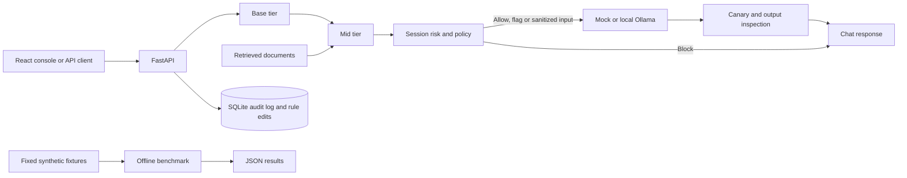

# Prompt-Injection Firewall

A local inspection console and FastAPI proxy for LLM messages, retrieved documents, and model responses. The default backend is a deterministic mock. The demo includes 20 retail documents, 84 labeled synthetic scenarios, and 200 benign prompts.

## Run locally

With Docker and Compose installed, run the stack and open [the console](http://127.0.0.1:5173).

```sh
docker compose up --build
```

Compose trains the classifier during the backend image build. It binds the web console to loopback and keeps the API inside the Compose network. The frontend proxies API calls on the same origin. The named volume stores SQLite request logs and rule edits.

For development, use Python 3.11 or later and Node 24. Run the backend and frontend commands in separate terminals from the repository root.

```sh
python -m pip install -r backend/requirements.txt pytest black ruff
python -m backend.training.train_classifier
python -m uvicorn backend.main:app --host 127.0.0.1 --port 8000
```

```sh
cd frontend
npm ci --ignore-scripts
npm run dev -- --host 127.0.0.1
```

Copy `.env.example` to `.env` to customize the backend. Mock is the default. To use an installed Ollama model outside Compose, set `PI_FIREWALL_BACKEND=ollama` and `PI_FIREWALL_OLLAMA_MODEL` in the environment file. The adapter connects to the local [Ollama chat API](https://docs.ollama.com/api/chat) at port 11434. It sends the current message, configured retrieval context, and an ephemeral canary when enabled. The benchmark and Attack Lab always instantiate the bundled mock directly.

## Architecture



- **Base.** The proxy normalizes text and analyzes a bounded set of decoded views. Aho–Corasick finds weighted phrases and a calibrated TF-IDF logistic model scores the text. YAML weights and thresholds turn the fused score into allow, flag, sanitize, or block. Sanitize replaces the risky input with a neutral message.
- **Mid.** Cosine similarity returns the nearest known scenario. A separate document scanner examines hidden markup and instructions addressed to the assistant, discards affected chunks, and wraps surviving text as untrusted data.
- **Advanced.** Session markers detect several forms of disclosure, output checks look for secrets and external destinations, and risk accumulates with exponential decay. A token bucket cools down clients after repeated blocks.
- **Console.** Playground shows each layer’s findings. Attack Lab compares bundled scenarios side by side. Dashboard polls recent SQLite decisions and latency. Document Scanner previews context, Model Lab recomputes held-out metrics as its slider moves, and Rules saves phrase and threshold edits to SQLite.

Edit `backend/config.yaml` to toggle tiers independently and set fusion weights, thresholds, session controls, and allowlisted output domains. Changes to YAML take effect on restart. Saved console overrides retain precedence for phrase rules and decision thresholds. `backend/rules/phrases.yaml` supplies the initial phrases.

## Reproduce the results

```sh
make seed && make eval
```

Without Make, run the equivalent Python commands.

```sh
python -m backend.training.train_classifier
python -m backend.eval.benchmark
python -m backend.eval.suite --phase advanced
```

[Baseline results](backend/eval/results.json) and [tier, mutation, and held-out metrics](backend/eval/suite_results.json) are saved as JSON. ASR counts scenarios where the synthetic marker reached the response. Recall counts any flag, sanitize, or block. The mutation column evaluates the advanced tier with 588 fixed variants of harmless labels plus the same 200 benign controls. Latency is in-process per scenario and includes every turn.

| Metric | Firewall off | Base | Mid | Advanced | Mutated set |
| --- | ---: | ---: | ---: | ---: | ---: |
| Synthetic ASR | 66.67% | 42.86% | 17.86% | 0% | 0% |
| Alert recall | 0% | 95.24% | 96.43% | 98.81% | 100% |
| Benign false-positive rate | 0% | 0% | 0% | 0% | 0% |
| p95 latency | 0.01 ms | 11.17 ms | 14.99 ms | 17.86 ms | 34.95 ms |

The classifier uses stratified train, validation, and test splits. Calibration uses training folds. The validation split selects a threshold targeting at most 5% benign false positives. Model Lab uses the held-out predictions, while the tier benchmark also includes training scenarios. The report records held-out patterns-only, ML-only, and combined runs and the confusion matrix for each.

### Optional embeddings

Install `backend/requirements-embeddings.txt` and point `PI_FIREWALL_EMBEDDING_MODEL` at a trusted local sentence-transformer directory, such as [all-MiniLM-L6-v2](https://huggingface.co/sentence-transformers/all-MiniLM-L6-v2). The service only loads local files. The mid tier compares TF-IDF, embeddings, and combined features using validation average precision and uses the highest-scoring classifier. It uses sentence embeddings for nearest-neighbor scoring when configured, and TF-IDF cosine similarity by default.

In the verified MiniLM run at revision `1110a243fdf4706b3f48f1d95db1a4f5529b4d41`, all three classifiers tied at 1.000 validation average precision. The tie kept TF-IDF for classification. MiniLM still supplied the nearest-neighbor embeddings, with 17.86% synthetic ASR, 96.43% alert recall, 0% benign false-positive rate, and 40.13 ms p95 for the mid-tier run.

```sh
python -m pip install -r backend/requirements-embeddings.txt
PI_FIREWALL_EMBEDDING_MODEL=/absolute/path/to/model python -m backend.eval.suite --phase mid --output embedding-results.json
```

On PowerShell, use `$env:PI_FIREWALL_EMBEDDING_MODEL = 'C:/path/to/model'` before running the Python command.

## Tests

With the console running, try these three checks with the default configuration.

1. In **Playground**, send `What are the store hours?` with **No document** selected. Verify **Allow** and open the inspection trace.
2. In **Attack Lab**, run scenario `META-01`. Verify that **Firewall off** shows the synthetic marker and **Firewall on** withholds it. **Run all fixtures** compares all 84 bundled scenarios.
3. In **Document Scanner**, scan the prefilled HTML. Verify that the hidden fixture marker causes the chunk to be withheld.

Run the automated checks from the repository root. On Windows, the Python commands work without Make.

```sh
python -m pytest -q
python -m backend.eval.suite --phase advanced
```

```sh
make lint test
cd frontend
npm run build
```

## Limitations

- This firewall reduces risk and cannot guarantee prompt-injection prevention. The synthetic events, mock disclosures, and inert image previews measure simulator behavior. They give no estimate of real-provider susceptibility or detection quality.
- Advanced blocked every observed disclosure here. In the full synthetic run, `DOC-08` still passed without an alert. Its built-in document has an archived fixture marker and the mock returned no secret. The report records missed alerts and observed disclosures independently for each variant. Fixed label changes cover only the variants represented in the suite.
- Normalization is bounded. Hidden markup scanning does not evaluate browser stylesheets or run scripts. Output matching covers specific URL and token forms and can block legitimate URLs or identifiers. The API returns output as text and the console never renders model-generated markup as HTML.
- Session enforcement is process-local. The rate limiter uses the connecting client address, which can be shared behind a reverse proxy. SQLite stores original and normalized messages until the local database is deleted. The console is intended for use on loopback since the rule editor and telemetry are available to anyone who can reach it.
- The benchmark uses original local fixtures. The external deepset dataset is excluded. Its [dataset card](https://huggingface.co/datasets/deepset/prompt-injections/raw/main/README.md) lists Apache-2.0 at the top level and CC BY 4.0 under dataset metadata. MiniLM is optional and has its own [Apache-2.0 model license](https://huggingface.co/sentence-transformers/all-MiniLM-L6-v2).
